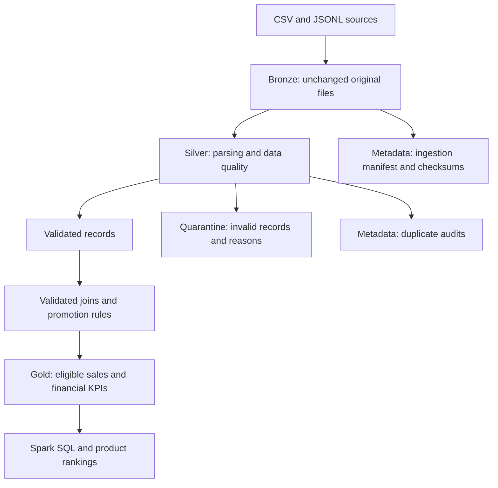

# E-shop Data Lakehouse | ETL with Apache Spark

A reproducible **batch data engineering pipeline** built with **PySpark and Spark SQL** for an e-commerce dataset. The project implements a Medallion-style architecture (**Bronze / Silver / Gold**) to ingest raw files, enforce data quality, trace rejected records, and produce reliable sales analytics.

> **Project context:** Academic practical assignment — *Implementation of an ETL Pipeline and Data Lakehouse (Bronze/Silver/Gold)*. The dataset intentionally contains errors; source records are never manually cleaned before ingestion.

## Architecture



| Layer | Purpose |
| --- | --- |
| **Bronze** | Preserve original CSV/JSONL files, compute SHA-256 checksums, and record ingestion metadata. |
| **Silver** | Parse types, validate business keys and references, quarantine invalid records, and audit exact duplicates. |
| **Gold** | Build eligible sales lines, compute net revenue/cost/margin, and produce business summaries and rankings. |
| **Metadata** | Keep ingestion manifests, duplicate audits, and validation artifacts. |

## Technology stack

- **Apache Spark / PySpark** — distributed DataFrame transformations and quality checks
- **Spark SQL** — analytical SQL queries and window functions
- **Python & Jupyter Notebook** — implementation and execution
- **Parquet** — persistent Silver, Gold, quarantine, and audit datasets
- **Docker** — reproducible local Jupyter + PySpark environment
- **Git** — version control for the notebook and project documentation

The notebook was developed using the `quay.io/jupyter/pyspark-notebook:spark-3.5.3` image and Spark in local mode (`local[*]`). No external cloud service is required.

## Data sources

| Source | Format | Raw records | Description |
| --- | --- | ---: | --- |
| `customers.csv` | Semicolon-delimited CSV | 32 | Customer identifiers, names, regions, registration dates |
| `products.csv` | Semicolon-delimited CSV | 14 | Product catalog, categories, list prices, unit costs |
| `orders.csv` | Semicolon-delimited CSV | 44 | Orders, customer references, dates, status, promotion codes |
| `order_items.csv` | Semicolon-delimited CSV | 86 | Purchased items, quantities, transaction prices |
| `promotions.jsonl` | JSON Lines | 6 | Discount codes, rates, validity periods |

Initial CSV fields are read as strings to preserve malformed values for auditing. JSON Lines are first read as raw text so a malformed JSON record can be quarantined without losing its original content.

## Repository structure

```text
E-shop/
├── README.md
├── data/
│   └── source/                  # Five original input files (not committed)
├── notebooks/
│   └── TP_E-shop.ipynb          # End-to-end notebook
├── scripts/                     # Optional reusable scripts
└── data_lakehouse/              # Generated locally (not committed)
    ├── bronze/
    │   └── original/            # Unchanged source copies
    ├── silver/
    │   ├── customers/
    │   ├── products/
    │   ├── promotions/
    │   ├── orders/
    │   └── order_items/
    ├── gold/
    │   ├── sales_lines/
    │   ├── global_kpis/
    │   ├── category_kpis/
    │   └── product_ranking/
    ├── quarantine/              # Invalid records, by source
    └── metadata/                # Ingestion manifests, duplicate audits,
                                 # and optional test baselines
```

Storage paths shown above follow the notebook's local layout; metadata filenames may depend on the execution run. Generated datasets are intentionally excluded from Git.

## Run locally

**Requirements:** Docker Desktop, a Git checkout of this repository, and the five unmodified source files supplied with the assignment.

1. Place all five files in `data/source/`, keeping their original names and contents.
2. Open PowerShell in the repository root and start Jupyter + PySpark:

   ```powershell
   docker run --rm -it --name eshop-spark `
     -p 8888:8888 -p 4040:4040 `
     -v "${PWD}:/home/jovyan/work" `
     quay.io/jupyter/pyspark-notebook:spark-3.5.3
   ```

3. Open the Jupyter URL printed in the container logs (or connect VS Code to its Jupyter server on port **8888**).
4. Open `notebooks/TP_E-shop.ipynb` and run the cells **in order**, starting with the Spark session and ingestion sections.
5. Inspect Spark's application UI at `http://localhost:4040` while a local Spark application is running.

The repository is mounted inside the container at `/home/jovyan/work`, so data saved under `data_lakehouse/` remains on the host when the container stops.

## Processing and data-quality rules

**Bronze**
- Copy each original file without modifying it.
- Compare SHA-256 hashes and record source, row count, path, ingestion time, status, and `run_id` in an ingestion manifest.

**Silver**
- Validate required identifiers and fields; explicitly parse dates, integers, and decimals.
- Reject malformed dates/JSON, nonnumeric prices or quantities, negative costs, and nonpositive item quantities as specified by the source rules.
- Check customer, order, and product foreign-key references against validated Silver tables.
- Preserve one canonical copy of every exact duplicate and record additional copies in an audit dataset.
- Quarantine invalid records with a `quality_reason`; keep valid `PENDING` and `CANCELLED` orders in Silver.
- Track promotion anomalies separately from structural quality failures.

**Gold**
- Include only orders with status `PAID` or `DELIVERED` in sales KPIs.
- Apply a discount only when its code is known **and** the order date falls within its validity period; otherwise use a **0%** discount.
- Use the **transaction price** from `order_items`, not the catalog price from `products`.
- Calculate financial amounts per sales line using decimal values and Spark `round(..., 2)` (half-up to cents) before aggregation.

```text
Net revenue = quantity × transaction unit price × (1 − applicable discount)
Total cost  = quantity × product unit cost
Margin      = net revenue − total cost
Margin rate = total margin / total net revenue × 100
Avg. basket = total net revenue / distinct eligible orders
```

Ratios with a zero denominator are left null rather than forced to an arbitrary value.

## Observed Silver quality results

The following record counts were obtained from the Spark quality pipeline:

| Dataset | Raw | Valid Silver | Quarantine | Extra exact-duplicate copies |
| --- | ---: | ---: | ---: | ---: |
| Customers | 32 | 30 | 1 | 1 |
| Products | 14 | 12 | 1 | 1 |
| Promotions | 6 | 5 | 1 | 0 |
| Orders | 44 | 40 | 3 | 1 |
| Order items | 86 | 80 | 5 | 1 |
| **Total** | **182** | **167** | **11** | **4** |

Each source satisfies the conservation rule:

`Raw records = valid canonical records + quarantined records + extra duplicate copies`

> The aggregate is **167** Silver records (30 + 12 + 5 + 40 + 80). This count includes orders that are valid in Silver but excluded from sales because of their status.

## Gold analytics

The notebook builds these Parquet outputs:

| Table | Description |
| --- | --- |
| `sales_lines` | Eligible order items with applied discounts, net revenue, cost, and margin |
| `global_kpis` | Global sales, customer, quantity, revenue, margin, and basket metrics |
| `category_kpis` | Revenue, cost, margin, and margin rate per product category |
| `product_ranking` | Product performance using `rank`, `dense_rank`, and `row_number` window functions |

Spark SQL queries cover eligible orders, global revenue, category performance, top products, monthly sales, top customers, and product rankings within categories. SQL totals are cross-checked against DataFrame aggregations.

### Reference KPI targets

The assignment provides the following **expected results**. These are **validation targets**, not a claim that every value has been verified in the current repository execution.

| KPI | Expected |
| --- | ---: |
| Eligible orders | 20 |
| Gold sales lines | 40 |
| Distinct customers | 20 |
| Units sold | 120 |
| Net revenue | 13,259.80 |
| Total cost | 9,150.00 |
| Total margin | 4,109.80 |
| Margin / net revenue | 30.99% |
| Average order value | 662.99 |

## Validation and reproducibility

The notebook includes checks for:

- **Volume conservation:** valid + quarantined + duplicate copies = source rows.
- **Join cardinality:** prevent unexpected row multiplication caused by nonunique reference keys.
- **Financial reconciliation:** margin = net revenue − cost.
- **Cross-API consistency:** Spark SQL totals match PySpark DataFrame totals.
- **Persistence:** reload Parquet outputs from disk and compare row counts / financial totals.
- **Idempotence:** preserve a first-run Gold baseline, rerun the pipeline from the same sources, and compare outputs using bidirectional `exceptAll()` checks.

**Validation status:** Silver counts above were observed. Final Gold KPI and end-to-end idempotence results should be taken from a successful notebook execution; this README does not certify those tests as passing without the execution output.

## Limitations and next steps

- This is a **local, batch-oriented teaching project** rather than a production orchestrated pipeline.
- The lakehouse layers use **Parquet folders**, not an ACID table format such as Delta Lake.
- Replaying the same input may produce a new ingestion `run_id` and timestamp even when the business outputs are identical.
- For larger datasets, consider parameterized jobs, structured logging, automated tests, partitioning, and orchestration with Airflow or Spark scheduled jobs.

## License and dataset provenance

The dataset and exercise specifications are provided for an academic TP. Check redistribution permissions before publishing the original source files. This repository focuses on the implementation and documentation of the processing pipeline.
